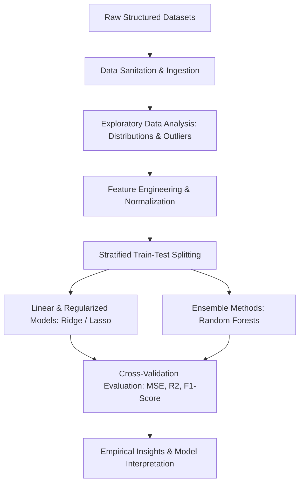

<div align="center">


[](https://www.python.org/)
[](https://pandas.pydata.org/)
[](https://scikit-learn.org/)
[](#)
[](#)

</div>

---

## 📌 Executive Summary / Overview

The **Applied Data Science Research Lab** (`DATA-SCIENCE-`) is an academic and empirical research repository dedicated to data science foundations, statistical inference, feature transformation pipelines, and predictive machine learning models.

Modern data science requires strict mathematical rigor: validating underlying data distribution assumptions, correcting sample selection biases, engineering non-linear feature interactions, and selecting optimal inductive biases for supervised learners. This repository encapsulates structured data processing methodologies, regression frameworks, and statistical diagnostic visualizations.

---

## 📖 Interactive Table of Contents

- [Executive Summary / Overview](#-executive-summary--overview)
- [Key Features & Capabilities](#-key-features--capabilities)
- [System Architecture & Data Science Pipeline](#-system-architecture--data-science-pipeline)
- [Tech Stack Breakdown](#-tech-stack-breakdown)
- [Methodological Framework & Best Practices](#-methodological-framework--best-practices)
- [Reproducible Quickstart & Setup](#-reproducible-quickstart--setup)
- [Project Directory Layout](#-project-directory-layout)
- [Author & Contributions](#-author--contributions)

---

## ✨ Key Features & Capabilities

- **Disciplined Data Ingestion & Auditing**: Standardized routines for detecting anomalous values, high-cardinality features, and systemic missingness.
- **Advanced Feature Engineering**: Numerical standardization (`StandardScaler`, `MinMaxScaler`), categorical one-hot encoding, and interaction term generation.
- **Exploratory Statistical Profiling**: Multi-dimensional covariance heatmaps, quantile-quantile (Q-Q) plots, and kernel density estimation curves.
- **Predictive Regression & Classification**: Comparative evaluation of parametric algorithms (OLS, Ridge, Lasso) and non-parametric tree ensembles (Random Forests, Gradient Boosting).
- **Cross-Validation & Generalization**: Implements $k$-fold cross-validation and stratified sampling to mitigate data leakage and overfitting.

---

## 🏗️ System Architecture & Data Science Pipeline



---

## 🛠️ Tech Stack Breakdown

| Category | Technologies & Tools |
| :--- | :--- |
| **Language** | Python 3.9+ |
| **Data Processing** | Pandas (DataFrames, GroupBy, Indexing), NumPy |
| **Machine Learning** | Scikit-Learn (Pipelines, Preprocessing, LinearModels, Ensembles) |
| **Visualization** | Seaborn, Matplotlib |
| **Environment** | Jupyter Notebooks, Google Colab |

---

## 🔬 Methodological Framework & Best Practices

| Stage | Process Objective | Standard Tools Used |
| :--- | :--- | :--- |
| **1. Cleaning** | Outlier detection, duplicate dropping, null value imputation | Pandas, NumPy |
| **2. EDA** | Univariate distribution tests, bivariate correlations | Seaborn, Matplotlib |
| **3. Modeling** | Hyperparameter cross-validation, cost function minimization | Scikit-Learn GridSearchCV |
| **4. Inference** | Residual analysis, feature importance ranking | Scikit-Learn, SciPy |

---

## 🚀 Reproducible Quickstart & Setup

### Prerequisites
- Python 3.9 or higher

### Step 1: Clone the Repository
```bash
git clone https://github.com/Jeshwanthika07/DATA-SCIENCE-.git
cd DATA-SCIENCE-
```

### Step 2: Set Up Virtual Environment
```bash
python -m venv venv
# On Windows:
.\venv\Scripts\activate
# On Linux/macOS:
source venv/bin/activate

pip install numpy pandas scikit-learn matplotlib seaborn jupyterlab
```

---

## 📂 Project Directory Layout

```text
DATA-SCIENCE-/
│
├── README.md                  # Comprehensive empirical data science documentation
└── LICENSE                    # Open-source MIT license
```

---

## 👩‍💻 Author & Contributions

Authored by **[Jeshwanthika Pothamchetty](https://github.com/Jeshwanthika07)**  
*Alliance University | Department of Computer Applications*

<div align="center">


</div>
